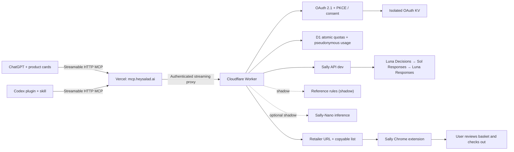

# Sally by HeySalad® — love your food

HeySalad Inc.’s AI grocery assistant for ChatGPT and Codex. AGPL-3.0-only.

**Public beta endpoint:** https://mcp.heysalad.ai/mcp

**Verified ChatGPT developer app:** [Sally by HeySalad® — public beta](https://chatgpt.com/plugins/plugin_asdk_app_6ad04e7ade948191b45443bdb9f8ea74) (public MCP origin; private development connection)

**Existing ChatGPT staging:** https://sally-mcp-staging.heysalad-o.workers.dev/mcp

**Health:** https://mcp.heysalad.ai/health

Sally checks grocery candidates, explains choices, converts recipes to shopping lists and prepares a Sally Chrome extension handoff. **You always check out and pay.**

This staging build uses `sally-api-dev`, not a production rollout. Candidates come from retailer pages via the Sally extension or the user; there is no catalogue search. Rules are a shadow port of the Python reference, with 25 parity fixtures; trained Sally-Nano inference requires its checkpoint/service and a pinned SHA-256 digest. See [verification](submission/verification.md) for observed results and blockers.



The [Vercel front door](vercel-proxy/README.md) is deployed at `mcp.heysalad.ai`, backed by its own isolated Worker, D1 and OAuth KV. Existing ChatGPT staging remains available with its original issuer; accounts must reconnect when changing issuers. See [domain migration](docs/custom-domain.md).

## Install in Codex

Copy this into `~/.codex/config.toml` (or a project’s `.codex/config.toml`):

```toml
[mcp_servers.sally]
url = "https://mcp.heysalad.ai/mcp"
tool_timeout_sec = 120
```

Anonymous `match_products` works without sign-in. This beta currently permits email sign-in only for `peter@heysalad.ai`; general reviewer access is a remaining launch gate. Run `codex mcp login sally` to connect your Sally account for the other tools. Enter the email code yourself in the Sally sign-in page. Never put a token into the config or commit one.

For plugin packaging, `plugin/` contains the portable `plugin.json`, `mcp.json`, a skill and branding, plus the supported `.codex-plugin/plugin.json` / `.mcp.json` compatibility layout. Add the folder through your local plugin source during development; the public directory package is prepared, **not submitted**. See [official packaging documentation](https://developers.openai.com/plugins/build/plugins).

## Tools

| Tool             | Input                                                    | Result                                                                                                       | Access            |
| ---------------- | -------------------------------------------------------- | ------------------------------------------------------------------------------------------------------------ | ----------------- |
| `match_products` | `list`, `retailer`, `candidates` grouped by `item_index` | Best accepted candidate by API confidence, price as tie-break, size and amber notes; null when none accepted | Anonymous / OAuth |
| `explain_match`  | `item`, `product`                                        | API verdict, model, explanation, shadow status                                                               | OAuth             |
| `recipe_to_list` | `recipe_text`, `servings`                                | Normalised items; amber scaling note                                                                         | OAuth             |
| `basket_link`    | `list`, `retailer`                                       | Retailer URL, copyable list, manual extension instructions                                                   | OAuth             |

Retailers: `ocado`, `waitrose`, `tesco`, `asda`. Lists have at most 40 items. A matching call accepts candidates for at most ten items, up to three per item. Batch long lists. Candidate product URLs must belong to the retailer. Confidence is the matching API’s value or `null`, never invented. Price and image data remain caller-supplied observations.

Example input shape (illustrative test data, not a current price quote):

```json
{
  "list": [{ "name": "whole milk", "quantity": 2, "unit": "pints" }],
  "retailer": "ocado",
  "candidates": [
    {
      "item_index": 0,
      "products": [
        {
          "id": "observed-product-id",
          "name": "Whole milk",
          "price": 1.8,
          "currency": "GBP",
          "pack_size": "2 pints",
          "url": "https://www.ocado.com/products/observed-product-id",
          "in_stock": true
        }
      ]
    }
  ]
}
```

## Demo: plan my week’s shop for 4 at Ocado

1. Ask Sally: “Plan my week’s shop for 4 at Ocado.” Agree meals and dietary preferences.
2. Convert the recipes with `recipe_to_list`, `servings: 4`; confirm the scaling note.
3. Collect product candidates with the Sally Chrome extension, then match them. Display price, size, confidence and amber notes. Explain doubtful matches.
4. Use `basket_link`; open the retailer, paste the list into Sally, review and confirm extension basket additions. Review the basket and check out yourself.

## Develop and verify

Requires Node 22+ and Cloudflare access for staging deployment. Local tests use test responses; live smoke checks are reported separately.

```sh
npm ci
node scripts/configure-staging.mjs local
npx wrangler d1 migrations apply sally-mcp-staging --local
npm run dev
# In another terminal:
npm run typecheck
npm test
npm run build
npm run test:runtime # isolated workerd OAuth/D1/KV; no real mail or credentials
npm run smoke
npx @modelcontextprotocol/inspector --cli http://localhost:8787/mcp --transport http --method tools/list
```

`configure-staging.mjs local` creates a guest session on the dev Sally API and writes ignored `.dev.vars` with file mode 0600; values are never printed. Remote setup is `node scripts/configure-staging.mjs remote`, followed by `npm run deploy:staging`. Initial setup creates dedicated D1/KV resources and installs their IDs in `wrangler.jsonc`. Apply migrations only to that staging database. No production environment is defined here.

## Authentication and privacy

MCP OAuth uses Cloudflare’s OAuth 2.1 provider: S256 PKCE for public clients, resource-bound tokens, rotation, revocation, DCR/CIMD, browser-bound consent, exact redirect registration. The identity step uses Sally email OTP. Sally upstream tokens are encrypted inside OAuth grants by the provider; upstream credentials are never passed through to MCP clients. Expired upstream sessions require sign-in again. Anonymous requests use an isolated guest account; scheduled daily renewal stores its necessary token in OAuth KV with a 47-hour TTL.

D1 stores HMAC-pseudonymised subject, tool, status, duration and timestamp, never shopping lists, recipes, product text, email, raw IP or tokens. Usage expires after 30 days; quota entries expire at their window boundary and daily cleanup removes old rows. Anonymous subject hashes rotate daily. Quotas: 3 tool calls/minute anonymous, 30 signed-in, 300 globally; request traffic also has an atomic per-subject quota. Matching candidates do not bypass API authentication.

The Sally API has its own processing and retention; public launch requires review of its existing logging and authentication behavior. [Privacy policy draft](submission/privacy-policy.md) must be approved and published at https://heysalad.ai/sally/privacy before submission. Current source and host status are recorded in [backend integration](docs/backend.md).

## Brand and ownership

Owner: **HeySalad Inc.** Support: **peter@heysalad.ai**. Name: **Sally**. Tagline: **love your food**.

Cherry Red `#ed4c4c`, Peach `#faa09a`, Cream `#fff8f6`, ink `#1f1416`. Grandstander is restricted to headlines; Figtree is used elsewhere. Widget fonts are bundled as data URIs; no font tracker is contacted. Font licenses are in `ui/licenses/`.

## Sources and submission

- [OpenAI MCP server guide](https://developers.openai.com/plugins/build/mcp-server)
- [OpenAI authentication](https://developers.openai.com/plugins/build/auth)
- [Codex MCP configuration](https://learn.chatgpt.com/docs/extend/mcp?surface=cli)
- [Cloudflare OAuth provider](https://github.com/cloudflare/workers-oauth-provider)

See `submission/` for listing text, privacy draft, review instructions and screenshots. Peter submits. There is no checkout, payment, retailer credential collection or directory-submission code.

Private Sally-Nano inference is documented in [inference/README.md](inference/README.md). It loads a private mounted artifact, reuses the original Python features, and stays in shadow mode. Local checkpoint tests pass; inference hosting is still pending.

## Monthly shopping-list allowance — prepared, not enabled

Peter confirmed Free 10 / Pro 100 / Max unlimited submitted lists per month,
with Airwallex for paid plans. One list counts once, including candidate
checks, candidate batches, explanations within the list and a final sweep.
When returned, reuse `submission_id` with the same full list for retries or
candidate batches; pass `shopping_request_id` to explain a matched item. A
newly submitted list uses a new ID. Recipe preparation and manual basket links
do not consume a submitted-list allowance.

The client is behind `SALLY_LIST_BILLING=1`, currently unset. Activation depends
on the owning backend's two migrations, compatible extension client, verified
Sally-specific Airwallex customer/price mappings and explicit live rollout
approval. See [backend preparation](docs/backend.md) and
[backend PR #38](https://github.com/Hey-Salad/heysalad-payme/pull/38).
